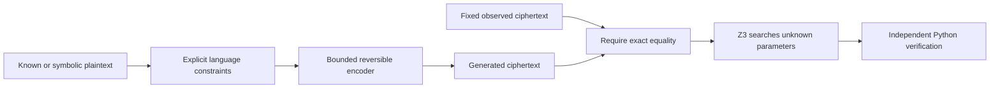

# Voynich SMT

An experimental Python framework for measuring how little reversible encoding
machinery can explain a text sample under explicit language constraints. The
central comparison is between Voynich text, known synthetic ciphertext,
pseudo-language, and randomized controls. The research specification is
[TODO.md](TODO.md).

## Current status

Start with the [structural coverage map](docs/approach_coverage.md): it separates
languages and German varieties, plaintext contractions, output expansions,
word/code boundaries, model assistance and strength of evidence. It marks
completed, parked and genuinely untested branches, with links to their reports.

The [section/line-position audit](docs/currier_section_position.md) qualifies
the A/B length contrast: within comparable herbal pages, the atomic gap shrinks
and its interval includes zero. The grouped gap remains positive because the
fixed EVA grouping shortens A words more. Common support covers only 15% of
clean B tokens, so this is not a manuscript-wide adjusted result.

The [shared-parameter A/B prediction audit](docs/currier_shared_parameters.md)
finds no joint mean/contrast match among 63 tested configurations, including
the fixed seven-contraction extension. The stationary prediction misses the
held-out length gap; the closest A candidate predicts the wrong direction.
These results do not exclude a shared cipher with different plaintext composition.

The [Currier structural-constraint census](docs/currier_structural_constraints.md)
now separates necessary length/repetition invariants from statistical scores.
Fixed-two output fails both A/B under atomic and existing grouped counting;
B mean word length is higher across two filters. Repeat differences are less
secure under folio resampling. This supplies candidate filters, not language
identification or a manuscript key.

The [cross-source transfer audit](docs/currier_mechanism_transfer.md) now
shows that these classifier scores should be parked for manuscript inference.
Broad decisions accept only 25% of genuine cases and almost no genuine renewal
cases; fine sparse-selection decisions have accepted errors. High control
rejection is not sufficient when known mechanisms are also mostly rejected.

The [blinded synthetic discrimination test](docs/currier_mechanism_discrimination.md)
now evaluates fresh passages with known mechanisms. It works well within the
Aquinas source, but Caesar sparse homophony remains mostly unresolved and has
accepted errors. The transfer audit above confirms that these scores are not ready to rank
Voynich mechanisms.

The [25-label capacity comparison](docs/currier_alphabet_comparison.md)
now tests monoalphabetic and sparse homophonic preserved-space codes. It finds
no consistent advantage from sparse homophony: lengths are unchanged and
repetition/position metrics trade off. The synthetic discrimination test above follows this screen; it does not yet
establish transfer to manuscript mechanisms.

The [one-glyph selection follow-up](docs/currier_selection_comparison.md)
shows that expansion costs affected the null comparison: positional nulls can
improve length compatibility once expansion is removed. Stable word selection
does not consistently improve repetition agreement. Its 52-symbol diagnostic
alphabet exceeds EVA capacity; resolve this before another solver campaign.

The [paired Currier A/B mechanism comparison](docs/currier_mechanism_comparison.md)
now compares preserved spaces, independent nulls, positional nulls and generated
boundaries. Nulls worsen length compatibility; renewal spacing can match the mean
but misses variance. These are compatibility screens, not hypothesis probabilities.

The recent [context-ranking diagnostic](docs/contraction_context_ranking.md)
adds no recovery benefit to the [covered contraction tests](docs/contraction_coverage_calibration.md).
The gap is identifying homophone groups and meanings. An oracle-grouping
instrument check is proposed but has not run. Short dictionary SATs and
full-text statistical measurements have not established a manuscript-wide key
or language. The coverage map is the current decision guide; the earlier
[research reset](docs/research_reset.md) supplies background.

Milestone 1 and hidden-plaintext synthetic recovery are implemented: atomic
alphabets and word-separated text, seeded
prefix-free encoders, Z3 recovery for monoalphabetic, homophonic, and bounded
variable-length homophonic codes, independent encoding/decoding verification,
447 passing tests, and 10/25/50-word benchmarks. Partial symbolic plaintext domains are
supported with fixed word lengths. A finite dictionary model supports fully hidden
plaintext with symbolic word lengths. Public recovery requests exclude ground
truth and can be saved and replayed. Bounded boundary nulls, lexicographic and weighted complexity minimization, and a
CLI are implemented. Provenance-tracked EVA and Latin corpora, normalization,
sampling, statistics, and seeded controls are implemented.
Broader hidden recovery now verifies all nine 10/25/50-word cases on the
24-symbol alphabet and 35-word fixture. A validated staged configuration covers
vocabulary widths and cipher-family bounds. See [the staged evaluation](docs/staged_recovery.md).
Original ZL EVA and Caesar Latin sources are retained locally with checksums and
provenance. See [the corpus milestone](docs/corpus_milestone.md) for normalization,
commands, and the deliberately restrictive real-text pilot.

The full eleven-word seed-7 control with 5,665 vocabulary entries has now produced
an independently verified hidden SAT fit using observed codeword domains in a
30-minute run. See [validation and the prepared Voynich retry](docs/observed_codes.md).
Other full-vocabulary seeds remain uncalibrated.

The 23-word Voynich retry is independently verified SAT at H2/L3 in 351.30
seconds. Its vocabulary fit includes English Gutenberg footer tokens and Roman
numerals; it is not a pure Latin plaintext finding. Fixing its used mappings
cannot extend to word 24. See [the witness, key and extension audit](docs/voynich_witness_extension.md).

Parser version 2 excludes the Gutenberg prose footer. A separately saved corpus
and 5,655-entry vocabulary preserve the historical inputs and invalidate the old
witness in the corrected vocabulary. The 30-minute-budget retry returned
UNSAT in 210.32 seconds, after the 30-second retry returned UNKNOWN.
See [the corrected 23-word retry](docs/clean_latin_retry.md).
The [vocabulary restoration diagnostic](docs/vocabulary_restoration.md) verifies
SAT when just `by/iv/of` are restored. Restoring `i/iv/iulius` without those
English entries returned UNSAT in 273.64 seconds; smaller subsets of these
three additions are therefore also UNSAT.
[Adding `by` and `of` separately](docs/english_word_restoration.md) returned
UNSAT in 334.41 and 306.72 seconds respectively; adding both admits the verified
old witness. Both entries are therefore necessary within this fixed add-back
comparison.
The [shortest-prefix search](docs/clean_latin_prefix.md) establishes an exact
boundary: 22 words independently verified SAT, 23 words UNSAT. The crossing
ciphertext word is `chololy`; this result concerns the fixed restored vocabulary
and H2/L3 model.
The [suffix search](docs/clean_latin_suffix.md) establishes words 2–23 as the
shortest UNSAT contiguous block anywhere in the original sample (22 words).
Deleting either endpoint admits an independently verified SAT witness.
The [selection-rule comparison](docs/conflict_selection.md) finds word-reset
cycles UNSAT in 18 seconds, while free homophone selection is independently
verified SAT in 321.07 seconds on the same block and vocabulary.
The [word-length diagnostic](docs/word_length_plausibility.md) finds this witness
unusually short compared with 20,400 Caesar passages. The ciphertext also
limits every fit to a mean plaintext length of at most 4.73; the fifth-percentile
Caesar passage mean is 5.09.
The [historical comparison](docs/historical_word_lengths.md) extends this
diagnostic to medieval Latin, nine 15th-century German varieties, medieval
Italian and Old Czech, preserving historical spelling and reporting
normalization sensitivities. The exact 104/22 ceiling admits 1.19% of Caesar
windows, 6.67% of medieval Latin windows, 70.48% of German windows, 58.49% of
Italian windows and 43.26% of the manuscript-style Czech verse windows.
These are empirical corpus proportions, not language probabilities.
The standalone analysis has 17 passing tests and does not invoke Z3.
The [German comparison](docs/german_selection.md) prepares the same 22-word
block under free and text-wide cyclic selection with a 2,160-word Middle
Bavarian vocabulary from Kottanerin's 1445–1452 manuscript witness. Historical
spelling is retained, including distinct umlaut letters. Short checks and
individual long-run replay commands are documented separately.
The longer German free-selection retry is independently verified SAT in
446.27 seconds. Its 64-letter plaintext has mean word length 2.91 but is a
dictionary fit rather than a grammatical passage. The matched text-wide
cyclic retry returned UNSAT in 229.95 seconds; request and provenance checks
are recorded, without independent UNSAT proof-certificate verification.
The [regional German cyclic probes](docs/german_regional_cycles.md) test the
other eight dated vocabularies separately, with checkpointed short checks and
a batch command for longer retries.
The completed longer regional batch found five independently verified cyclic
SAT fits (Swabian, East Franconian, Upper Saxon, Ripuarian and Alsatian).
Kottanerin, East Swabian, Hessian and Thuringian returned UNSAT. The five SAT
plaintexts have mean lengths 2.18–2.55, below every eligible 22-word window
mean in their respective source samples; they establish dictionary fits
rather than grammatical passages.
The [attested-passage check](docs/german_passages.md) scans 66,638 contiguous
22-word German windows. Eight pass the positionwise length filter, and all
eight are UNSAT. Equal ciphertext words would decode to different source
words in each candidate, so independently checked repetition contradictions
also exclude them without imposing cycling.
The [Latin contraction pilot](docs/latin_contractions.md) measures ae alone
and seven distinct historical ligature/abbreviation units, with optional
non-overlapping applications and exact expansion checks. The pooled medieval
Latin total-ceiling fraction rises from 6.67% to 13.31%, but no sampled passage
meets the positionwise lengths. This is a solver-free capacity analysis.
The [remaining-length diagnostic](docs/latin_length_failures.md) ranks the
closest Latin windows and separates excess length, insufficient length and
repetition conflicts. Only two of 42,213 windows match the block's repeated
word pattern; the best of those still fails 13 positions under seven units.
The [expanded medieval sample](docs/expanded_medieval_latin.md) adds Einhard,
Gesta Francorum, Philobiblon and Dante's Monarchia, bringing the medieval
sample to 80,024 windows. Four meet the exact repetition pattern; the best
of those still fails eight positions. No positionwise length match is found.
The [bounded boundary-edit test](docs/word_boundary_edits.md) allows up to two
insertions/deletions of ciphertext word boundaries while retaining all 104
characters. Seven historical units yield 83 length-compatible alignments
against attested 20–24-word passages; every alignment fails exact repetition.
These candidates are excluded without Z3.
The [fixed German extension test](docs/german_scaling.md) rechecks the
22-word free-selection SAT witness and proves the 23-word prefix impossible:
the next ciphertext word is `s`, while the unchanged vocabulary contains no
one-letter words. Longer nested prefixes inherit this length obstruction;
no long solver run is needed.
The [audited Upper Saxon cyclic extension](docs/german_cyclic_scaling.md)
uses an attested one-letter `o`, avoiding that vocabulary-length obstruction.
Its original 22-word SAT witness verifies, but the 23-word extension is UNSAT
in 15.80 seconds. Two known-positive hidden controls remain UNKNOWN at five
seconds; no independent UNSAT proof certificate was checked.
The [selection-only comparison](docs/german_free_extension.md) relaxes cycling
on exactly the same 23-word Upper Saxon request. Free selection initially
timed out at 30 seconds, then returned independently verified SAT in 35.18
seconds with a longer budget. Text-wide cycling excludes a fit that free
selection admits within this fixed dictionary and cipher model.
The unchanged free-selection model's 30-word extension returned UNSAT in
52.56 seconds on the longer retry. The smallest excluded prefix lies within
24–30 words; the prepared 40- and 51-word prefixes inherit the contradiction.
The [completed minimal-prefix search](docs/german_free_prefix.md) establishes
28 words independently verified SAT and 29 words UNSAT. Adding `otaldam`
crosses the prefix boundary within the fixed German free-selection model.
The [completed suffix reduction](docs/german_free_suffix.md) shrinks that
conflict to 25 words, original positions 5–29. Deleting either endpoint gives
independently verified SAT, so the conflict is minimal under contiguous
trimming; minimality under arbitrary deletions remains unresolved.
The [interior deletion diagnostic](docs/german_word_deletions.md) removes four
redundant copies of `chor`/`cham`, reducing the free-selection conflict to
21 distinct words by exact feasibility equivalence. Both endpoint deletions
remain verified SAT. The completed single-deletion scan finds 19 SAT results
and two UNSAT deletions (`daiin` or `ychtaiin`). Removing both returns UNSAT
in 44.60 seconds, yielding an inclusion-minimal 19-word conflict. All 19
single-deletion SAT certificates are independently verified.
The [German vocabulary robustness comparison](docs/german_vocabulary_robustness.md)
keeps this 19-word free-selection conflict fixed across the other eight
existing dictionaries. East Swabian and Thuringian return UNSAT; Kottanerin
and Hessian fail the one-letter length check. The other four dictionaries
all return independently verified SAT on longer retries. The 19-word
exclusion therefore depends on the selected vocabulary and its alphabet.
The [full-block restoration](docs/german_full_block.md) uses the surviving
East Franconian vocabulary on all 30 original consecutive words. The longer
retry returns independently verified SAT in 349.69 seconds, confirming that
the full-block source-143 exclusion is vocabulary-dependent as well.
The [short-form audit](docs/german_short_form_audit.md) traces the witness's
`k` to unexplained `k x k` prayer sequences. A separate dictionary-only
variant removes `k` and `x` while retaining attested `o`; it returns UNSAT
in 5.55 seconds. The original full-block SAT requires at least one of
those unexplained entries.
The [audit of the other survivors](docs/german_regional_audit.md) finds that
Swabian `t/u` were fragments of `[T]U`, Alsatian `r` was a fragment of
uncertain `a[?]r`, and Ripuarian `h/u` came from an alphabet mention and a
marked form. Separate corrected vocabularies retain supported one-letter
forms and have separately versioned full-block inputs.
The corrected full-block retries return independently verified SAT for
Swabian and Alsatian, using supported one-letter `a` and `e` respectively,
and UNSAT for Ripuarian. Compatibility therefore survives the normalization
and lexical corrections for two vocabularies.
The [matched shuffle comparison](docs/german_shuffle_controls.md) prepares
12 paired shuffle tests and four verified positive controls for these two
models. Four 30-second probes returned UNKNOWN; the 30-minute batch is ready
for a local run, with no comparative compatibility conclusion yet.
The narrowed 30-minute follow-up returned UNKNOWN for a global shuffle and
verified SAT for its known-positive control. The German branch is now paused.
The [Latin dictionary contraction screen](docs/latin_dictionary_contractions.md)
records additional length-feasible words under the existing reversible inventory;
it makes no shared-key or SAT claim.
The [mixed contraction recovery gate](docs/mixed_contraction_gate.md) now passes
three small synthetic cases with independently verified SAT. Complete optional
tokenizations preserve distinct paths of equal length; larger-scale recovery
performance remains to be measured.
In the [full-vocabulary contraction pilot](docs/latin_mixed_comparison.md),
the seven-unit positive returned verified SAT in 7.14 seconds; its Voynich
probe returned UNKNOWN at 10 seconds. One capped 30-minute attempt is prepared.
That long attempt returned verified SAT in 591.84 seconds, using only `ae`.
Deleting unused contraction mappings also certifies the ae-only model as SAT.
The expanded sequence is a dictionary fit, not readable Latin; the matching
letters-only free-selection comparison remains unresolved.
The matching letters-only run subsequently returned independently verified
SAT in 343.35 seconds. Contractions are therefore unnecessary for this block's
free-selection dictionary compatibility. The fixed contraction pilot is complete;
neither recovered sequence is a grammatical Latin passage.
The [single EVA tokenization sensitivity](docs/eva_tokenization.md) groups
ch/sh and four benched-gallows forms. The fixed 22-word block shrinks from
104 to 85 units (mean ceiling 3.86); no scanned attested passage passes the
grouped length/repetition filters. No solver calls or new inventories were added.
The [preselected cross-section screen](docs/cross_window_passages.md) tests
ten non-overlapping windows under both inventories. Two have necessary-filter
passage survivors; eight do not. Both surviving windows lack repeated words,
so this changes the fixed-block result without establishing a cipher fit.
The [word repetition diagnostics](docs/research/word_repetition.md) compare all
ten saved windows and a separate opening reference with 24 source streams.
The opening block's repetition amount is common in several prose comparanda;
its exact repeat placement is much more selective. No language likelihood or
new cipher fit is inferred.
The [thematic Latin audit](docs/research/thematic_latin_passages.md) adds
barrier-preserving Emerald, Grosseteste and Manilius streams; none passes the
fixed ten-window length screen. Turba's former Latin-labeled statistics are
quarantined because their extraction includes English prose.
The [surviving-passage audit](docs/passage_survivor_audit.md) recovers all
25 match entries at exact source positions. Six Swabian dramatic-source entries
have lexical sensitivity flags; three grouped German/Dante matches remain
without those flags. These remain necessary-filter candidates, not cipher fits.
The [known-passage shared-key gate](docs/known_passage_keys.md) subsequently
returns UNSAT for all three grouped candidates. Small independently checked
prefix obstructions explain why their passing word lengths were insufficient.
The [frozen-key next-block test](docs/frozen_key_holdout.md) finds only 8–12
fully decoded words per 22-word holdout. Total dictionary hits beat matched
shuffles, but most are repeats from training; novel hits are Latin 2, Swabian 1
and Alsatian 0. None of these keys explains its complete next block.
The [fixed predictive-calibration benchmark](docs/predictive_calibration.md)
prepares six matched-word-count cases and verifies perfect generating-key
continuation coverage. Its Latin ten-second recovery smoke test is UNKNOWN;
one 30-minute synthetic fit is the next gate before further Voynich fitting.
That full-budget synthetic fit also returned UNKNOWN after 1800.38 seconds;
no held-out prediction was evaluated. The remaining five cases are deferred
while recovery calibration is unresolved.
The [fixed-key synthetic size ladder](docs/synthetic_size_ladder.md) also
returns UNKNOWN for 5, 10 and 15 fitting words at ten seconds each. These
known-solvable cases have no prediction scores; the matrix remains deferred.
The [plaintext-revealed diagnostic](docs/known_plaintext_ladder.md) returns
verified SAT for those prefixes in under one second, isolating hidden-word
search as the main bottleneck on these cases. Correct continuation words
coincide with coverage of the generating homophones observed in training.
The [reduced-vocabulary calibration](docs/reduced_vocabulary_calibration.md)
tests a fixed 64/128/256-entry ladder. One five-word fit returns verified SAT
but decodes 0/22 continuation words; eight other short fits remain UNKNOWN.
The predictive benchmark remains deferred.
The [tiny multiple-explanation diagnostic](docs/tiny_key_ambiguity.md) finds
six distinct verified training fits whose continuation dictionary scores range
from 0/4 to 4/4 despite complete coverage of the generating homophones.
One arbitrary SAT witness is insufficient to assess predictive potential;
the good key cannot be selected using its evaluation score without consuming
that continuation as validation.

## Setup

Use Python 3.12 or newer and uv:

```sh
uv sync
uv run python -c 'import z3; print(z3.get_version_string())'
```

`z3-solver` is the only initial runtime dependency. `pytest` is included in the
development group. Run `uv run pytest` to check the solver and encoders. The
included `uv.lock` preserves dependency versions. The CLI uses the standard library; no additional runtime dependencies are required.

```sh
uv run pytest -q
uv run python benchmarks/recovery.py --seed 1729 --timeout-ms 10000
uv run python benchmarks/hidden_recovery.py
uv run python benchmarks/staged_recovery.py
```

The benchmark writes `experiments/results/milestone1.json`, including the exact
sample, bounds, seed, versions, solver statistics, recovered codebook, choices,
segmentation, and verification. See [benchmark measurements](docs/milestone1.md).
The solver timeout applies to Z3's check; construction time is reported separately.

The hidden-recovery runner tests three seeds and both four- and 24-symbol
plaintext alphabets. Public inputs and ground truth are stored separately under
`data/generated/hidden-recovery/`. Results are checkpointed to
`experiments/results/hidden-recovery.json` after every run. UNKNOWN includes the
solver's reason and never counts as successful recovery.

## CLI and complexity minimization

Generate public ciphertext and separate private truth, then solve it:

```sh
uv run voynich-smt synthetic generate \
  --config experiments/configs/nulls-demo.json --words 5 --seed 7 \
  --output data/generated/demo-input.json \
  --ground-truth data/generated/demo-truth.json
uv run voynich-smt solve data/generated/demo-input.json \
  --optimize lexicographic --output experiments/results/demo.json
uv run voynich-smt compare experiments/results/demo.json
uv run voynich-smt corpus info data/generated/demo-input.json
```

Results include structural counts, scoring weights, objective bounds, sample
checksums, environment details, and independent verification. A verified SAT
result is distinguished from a proved minimum. The new benchmark verified 27/27
runs and proved minima in all 18 optimization runs on a small vocabulary.
See [nulls, optimization, and CLI](docs/nulls_optimization.md) for assumptions,
budget sweeps, weighted scoring, measurements, and scaling limits.

## Corpora and controls

```sh
uv run voynich-smt corpus fetch zl-eva
uv run voynich-smt corpus fetch caesar-latin
uv run voynich-smt corpus normalize data/raw/ZL3b-n.txt.manifest.json \
  --output data/processed/zl-eva.json
uv run voynich-smt corpus normalize data/raw/pg218.txt.manifest.json \
  --output data/processed/caesar-latin.json
uv run voynich-smt corpus sample data/processed/zl-eva.json \
  --words 5 --folio f1r --output data/generated/f1r-first5.json
uv run python benchmarks/corpus_comparison.py
```

Raw originals remain immutable and excluded from version control. Normalization
records uncertain readings and spaces, alphabet conventions, exclusions, and source
locations. EVA units are explicitly transliteration characters. Sample artifacts
record exact selection and checksums; the pilot creates separate solver requests.
The pilot's synthetic gate passed, while Voynich and five controls were UNSAT
under a 32-word vocabulary and restrictive bounds. This result concerns that
finite model and does not establish the manuscript's language.

## Wider vocabulary and cyclic homophones

```sh
uv run python benchmarks/latin_frontier.py
uv run python benchmarks/latin_frontier.py \
  --config experiments/configs/latin-frontier-lexical.json \
  --output experiments/results/latin-frontier-lexical.json \
  --artifact-dir data/generated/latin-frontier-lexical
```

Public requests support `"selection": {"mode": "cycle", "reset": "text"}` for
per-letter cycles continuing across spaces; `reset: "word"` restarts each word.
The default remains free occurrence choices. The five-word sample becomes SAT at
512 corpus vocabulary entries, including a variant excluding one-letter initials.
Verified full-vocabulary fits also use genuine cyclic homophones. Shuffled controls
fit too, and full-vocabulary synthetic recovery frequently times out.
See [the vocabulary and selection frontier](docs/latin_frontier.md) for exact
assumptions, 144 measured checks, witnesses, limitations, and replay commands.

## Fixed-model sample scaling

```sh
uv run python benchmarks/sample_scaling.py
uv run voynich-smt compare experiments/results/sample-scaling.json
```

The earliest clean 50-word paragraph-text span is on f3r. Its nested 5/10/25/50-word
prefixes share a fixed 5,665-entry vocabulary, at most two homophones, code lengths
1–2, and per-letter cycles continuing across spaces. Results: verified SAT at 5,
timeout at 10, and UNSAT at 25 and 50. The 10-word threshold remains unresolved.
See [sample scaling](docs/sample_scaling.md) for exact source indices, timings,
assumptions, interpretation, and replay commands.

The next diagnostic verifies SAT at 6 words and UNSAT at 23; lengths 7–22 remain
unresolved. An 11-word suffix ending at word 23 is UNSAT, and its 10-word suffix
is verified SAT. Free selection and word-reset cycles are UNSAT at 23; H3 and L3
remain UNKNOWN. Five glyph observations suffice for a contradiction when all
23 original word lengths and cyclic positions are retained. Their deletion
minimality is unresolved. See [UNSAT diagnostics](docs/unsat_boundary.md) for
the exact observations, model comparisons and reproduction commands.

Allowing codes of length 1–3 repairs the 11-word conflict with an independently
verified SAT model; the full 23-word prefix remains UNKNOWN after two-minute
checks. The new runner validates small hidden and full-alphabet known recovery,
records the unresolved full-vocabulary hidden controls, and compares equivalent
flat and trie dictionary formulas. See [length-three coding](docs/l3_conflict.md).

```sh
uv run python benchmarks/l3_conflict.py
uv run python benchmarks/l3_conflict.py --resume
```

Guided extension checks all 23 words using the recovered suffix key, allows
homophone-order rotations and releases mappings progressively. The seed's
`e -> {y, qo}` mapping alone is incompatible with the earlier forced cycle;
`cthol -> rt` supplies a separate vocabulary obstruction. These are conditional
key exclusions. See [guided extension](docs/guided_extension.md) for the search,
proofs, replay inputs and remaining full-model uncertainty.

Alternative-key search now retains independently checked full-prefix exclusions,
including separately replayed UNSAT cores. See [learned search](docs/learned_search.md)
for unchanged model assumptions, replay commands and interpretation. The
`benchmarks.learned_prefix` runner applies those exclusions to all 23 words
with every mapping free and a two-minute solver budget.

H2 cyclic recovery now shares Boolean phase updates instead of repeatedly
summing the full symbolic history. See [synthetic performance calibration](docs/cycle_performance.md)
for equivalent-formula checks, timings and full-vocabulary recovery limits.

Optional dictionary-entry selectors provide another equivalent membership formula.
See [dictionary selection](docs/dictionary_selection.md) for exact control comparisons
and full-vocabulary recovery limits.

[Synthetic prefix calibration](docs/synthetic_prefix.md) tests increasing prefixes
of one saved control with the full vocabulary to locate solver-budget difficulties.

A [four-word boundary diagnostic](docs/segmentation_diagnostic.md) compares
hidden recovery with explicitly supplied synthetic codeword boundaries.

The [word-length diagnostic](docs/word_length_diagnostic.md) isolates length
knowledge from exact boundaries on the same four-word control.

[Public length search](docs/length_search.md) explores admissible word-length
vectors without consulting synthetic truth, keeping unresolved branches explicit.

A [solver-engine comparison](docs/solver_engines.md) tests ordinary SMT and
`qffd` on an identical public length branch that stalls during calibration.

[Diverse length orderings](docs/length_orderings.md) preserve the complete search
space while varying which public length combinations receive early attempts.

An [observed codeword-domain experiment](docs/observed_codes.md) adds explicit
public substring domains while preserving unused mappings and the cipher model.

## Recovery API

```python
from voynich_smt.cipher.base import Bounds
from voynich_smt.models.alphabet import Alphabet
from voynich_smt.models.text import Text
from voynich_smt.solver.recovery import recover

result = recover(
    Text.from_string("abba"), Text.from_string("xyyx"),
    Alphabet(tuple("ab")), Alphabet(tuple("xy")),
    Bounds("monoalphabetic", 1, 1, 1),
)
assert result.status == "SAT" and result.verified
```

`Text.from_string` splits whitespace and treats each character as a token.
For multi-character atomic glyphs, construct `Text` from tuples of tokenized words.
Whitespace formatting is not preserved; word boundaries are. Caller tokenization
must be explicit. `domains={1: ("a", "b")}` makes token 1 symbolic; it does not
hide word lengths or impose a Latin language model.

## Hidden-plaintext recovery

```python
from voynich_smt.language.dictionary import WordDictionary
from voynich_smt.solver.recovery import recover_dictionary

result = recover_dictionary(
    ciphertext=Text.from_string("xyyx"),
    plain_alphabet=Alphabet(tuple("ab")),
    cipher_alphabet=Alphabet(tuple("xy")),
    bounds=Bounds("monoalphabetic", 1, 1, 1),
    dictionary=WordDictionary.from_strings(("abba", "baab")),
)
assert result.status == "SAT" and result.verified
```

No original plaintext, key, segmentation, or homophone choices are supplied.
Word lengths are selected from the vocabulary, subject to optional public
`min_word_length` and `max_word_length` bounds. The language constraint is exactly
dictionary membership per word, without grammar or frequency assumptions. A valid
explanation need not match the original plaintext or key.

`HiddenRecoveryRequest` in `voynich_smt.experiments.hidden` supports a serialized
public input contract. The loader rejects unknown top-level fields, including
hidden ground truth. Replay a saved public input independently:

```sh
uv run python benchmarks/hidden_recovery.py \
  --request data/generated/hidden-recovery/inputs/small-hidden-seed7-words10.json \
  --output experiments/results/replay.json
```

The replay uses the timeout and representation saved in the request.
The default `--representation finite` compiles bounded integer constraints to SAT
using Z3's finite-domain tactic. Minimization uses native Z3 Optimize. `ite`, `array`, `interval`, and `chunk` remain
available for comparison. All represent the same bounded prefix-free cipher family. See
[hidden recovery evaluation](docs/hidden_recovery.md) for measurements and limits.

The staged runner reads [staged-recovery.json](experiments/configs/staged-recovery.json).
It validates inputs before generation and records exact public requests, their
checksums, solver outcomes, verification, and completion of each validation stage.
Use `--representation` to compare backends and `--stages` to select named stages.
The fixtures constrain membership in a finite vocabulary, not unrestricted Latin.

## Implementation sequence

1. Establish explicit alphabets, symbol IDs, and separate word-boundary metadata.
   Define a pure Python encoder and a result format with seed, bounds, solver
   status, runtime, and verification outcome.
2. Implement known-plaintext monoalphabetic substitution and test tiny SAT,
   deliberately impossible UNSAT, and independent encoding round trips.
3. Add homophonic substitution with disjoint decoding ownership: a ciphertext
   symbol cannot represent two different plaintext symbols. Recover a valid
   explanation; equivalent keys need not match the generating key.
4. Add bounded variable-length homophones and symbolic segmentation. Start with
   prefix-free codebooks as an explicit sufficient condition for unambiguous
   decoding. Preserve spaces initially. Prefix-free constraints restrict the
   cipher family and must be reported as assumptions. Benchmark representations
   before relaxing that family.
5. Benchmark seeded synthetic examples at 10, 25, and 50 words. Record solver
   statistics and capacity, and independently reproduce every SAT ciphertext
   using the recovered key and occurrence choices. Evaluate performance before
   adding nulls, dictionaries, or optimization.
6. After synthetic validation, acquire a reputable EVA transcription and a
   public-domain Latin corpus, with provenance and configurable normalization.
   Validate hidden-plaintext recovery before interpreting real Voynich results.

Known-plaintext recovery validates the encoder constraints. Hidden recovery now
provides the separate synthetic check in TODO.md section 14, with dictionary
membership as the explicit language constraint. Success on a small finite
vocabulary does not establish reliability for unrestricted Latin or Voynich.

## Layout

```text
src/voynich_smt/     Importable Python package
  data/             Corpus ingestion, provenance, normalization, sampling
  models/           Alphabets, sequences, boundaries, segmentation records
  cipher/           Concrete encoders and bounded cipher-family definitions
  language/         Replaceable, explicit plaintext constraints
  solver/           Z3 construction, extraction, optimization, UNSAT reporting
  experiments/      Experiment orchestration and result serialization
  metrics/          Ordinary Python statistics and encoder capacity measures
tests/
  unit/             Small SAT/UNSAT cases and component checks
  integration/      Independent round trips and recovery regressions
data/
  raw/              Immutable downloaded originals and provenance manifests
  processed/        Derived normalized corpora with transformation metadata
  generated/        Seeded synthetic ciphertext and control datasets
experiments/
  configs/          Versioned experiment specifications
  results/          Generated JSON results; excluded from version control
benchmarks/         Reproducible scaling runners and benchmark definitions
docs/               Design decisions, acquisition policy, historical sources
```

`src/voynich_smt/data` contains code; top-level `data` contains datasets.
Unused package directories reserve responsibilities without claiming functionality.

## Model and interpretation



Homophonic encoding needs occurrence choices to reproduce a particular ciphertext;
store those choices with recovered explanations. Reversibility also requires
unique decoding, beyond verifying the forward match. Dedicated null glyphs are skipped during decoding and may be inserted only at
complete codeword boundaries. Context mechanisms remain planned.

SAT means an explanation exists within the encoded assumptions. UNSAT excludes
only that bounded model. UNKNOWN and timeouts are inconclusive. Neither SAT nor
UNSAT establishes the manuscript's language or whether it is encrypted.

Every experiment must report model capacity and exact sample identity. Complexity
weights are configurable conventions; report structural counts alongside scores.
Historical, linguistic, and statistical plausibility remain separate assessments.

The [toy word-sequence diagnostic](docs/tiny_word_sequence.md) adds a fixed
training word-pair rule. It rejects five of the six earlier explanations and
recovers a key predicting all four continuation words; the next used-ownership
search is UNSAT. This is an engineered toy prior, not independent language
calibration. Nine focused tests pass; protocol and results are recorded in
`experiments/results/tiny-word-sequence/`.

The [corpus-derived sequence-ranking pilot](docs/corpus_sequence_selection.md)
uses disjoint Caesar passages and a frozen smoothed score to rank three recovered
keys per synthetic/shuffled case. All twelve fits finish quickly, but ranking
produces no continuation improvement. Training codeword coverage is inadequate
in both positives, so this does not isolate the ranker's usefulness. Results and
independent validation are preserved; ten focused tests pass.

The [coverage-controlled ranking pilot](docs/coverage_sequence_selection.md)
preserves the frozen reference score and guarantees generating-code coverage
for all eight continuation words. First and ranked keys recover 4/4 and 1/4
exact words in the two positive blocks; ranking adds no benefit. Both paired
shuffles are UNSAT; one additional-key search is UNKNOWN. Nine focused tests
and independent artifact validation pass.

The [generating-key ranking diagnostic](docs/generating_key_ranking.md) injects
known keys into the saved coverage-control pools without new solves. The frozen
training score selects truth in the weaker block, raising exact predictions
from 1/4 to 4/4; in the other block it prefers an already perfect recovered key.
Candidate availability limits the weaker block, while true-key identification
remains inconsistent. This is truth-assisted calibration, not recovery success.
Seven focused tests and independent validation pass.

The [guided cross-model calibration](docs/guided_model_calibration.md) compares
Latin/Swabian, letters/bounded contractions and guided/ordinary proposals in
32 fixed arms. Ordinary recovery fits all four matching positives and rejects
all four matching shuffles; one cross-profile shuffle remains UNKNOWN. All
48 guided proposals fail shared-key feasibility. Five focused tests pass;
full provenance, validation and the failed construction preflight are preserved.

The [feasible sequence-search check](docs/feasible_sequence_search.md) keeps
shared-key constraints active while seeking a better integer training score.
Under matched five-second budgets, ordinary recovery gives 2/4 exact words
(two novel), while guided search gives 1/4 (none novel) and times out seeking an
improvement. Statistical guidance has not passed its gate; pause this branch.
Eleven focused tests and independent artifact validation pass.

The [local-structure control suite](docs/structured_negative_controls.md) preserves
aligned pair chunks or each word's overlapping bigrams/endpoints, plus lengths,
glyph counts and repetitions. All four paired positives are verified SAT; all
seven constructible controls are UNSAT in 13.33 total solver seconds. One
bigram construction is unavailable. Eleven focused tests and independent
artifact validation pass; the small dictionaries limit broader conclusions.

The [single-code baseline comparison](docs/single_code_baseline.md) compares
nested H1/H2 expansion on nineteen cases, with eleven existing fits reused.
Both models fit all four new H1 positives; only H2 fits the four H2 positives.
H2 also fits one corrupted Latin mixed control rejected by H1 and returns a
wrong first key for the matching uncorrupted H1 positive despite dictionary
hits. Repetition limits the prediction comparison. Ten focused tests and
independent validation pass.

The [novel-word holdout comparison](docs/novel_word_holdout.md) reserves three
word types absent from training, with all true continuation codes covered.
H1 recovers 3/3, 3/3, 3/3 and 2/3 novel words on its positives; H2 recovers
1/3, 0/3, 2/3 and 2/3 on those same ciphertexts. H2 recovers 2/3–3/3 on its
own positives. No repeats or timeouts; ten focused tests and validation pass.
The four-type construction failure is preserved; no inventory or seed expansion.

The [fresh Voynich screen](docs/fresh_voynich_screen.md) freezes f1v/f2r blocks
with 21/22 and 19/22 novel continuation occurrences, using full corrected
Latin/Swabian dictionaries and unchanged H1/H2/contraction profiles. Five-second
checks produce 5 UNSAT and 19 UNKNOWN outcomes, no fitted keys or predictions.
The f1v structural control is unavailable; all f2r control fits remain unresolved.
Ten focused tests and selection/control/request validation pass. Full-vocabulary
calibration/performance remains the obstacle; no manuscript-language conclusion.

The [full-vocabulary H1 positive](docs/full_vocabulary_h1.md) holds observations,
full Latin alphabet and budgets fixed while comparing 12 versus 5,655 dictionary
words. Reduced recovery is verified SAT and predicts 3/3 novel words; full
recovery is UNKNOWN at five seconds, with no prediction score. True generating
coverage and full-model compatibility are verified. Ten focused tests and
independent validation pass; dictionary-scale performance remains unresolved.

The [plaintext-revealed H1 diagnostic](docs/full_vocabulary_h1_known.md) removes
training word search from the preserved full-alphabet Latin positive while
keeping key/code lengths/segmentation hidden and the budget fixed. It is verified
SAT in 0.04 seconds and predicts all 3 novel words exactly, versus saved hidden
UNKNOWN at five seconds. Word selection and its length choices remain the
bottleneck; this is not hidden-recovery success. Ten focused tests pass.

The [word-length-only H1 diagnostic](docs/full_vocabulary_h1_lengths.md) retains
full dictionary word search but reveals training token counts. It reaches
verified SAT in 2.19 seconds and predicts 3/3 novel words, versus fully hidden
UNKNOWN at five seconds. Only 10/18 training words match truth, so ambiguity
persists. Length uncertainty is a performance target, not established manuscript
information. Ten focused tests and independent validation pass.

[Public midpoint length search](docs/full_vocabulary_h1_public_lengths.md) reaches
verified SAT in 2.20 seconds on the preserved full-vocabulary H1 positive and
predicts 3/3 novel words, within the same five-second solver budget. Lengths are
proposed from ciphertext and public bounds. This retrospective heuristic still
needs blind calibration across varied code lengths. Seven tests and independent
artifact validation pass.

[New-key public-length calibration](docs/public_length_calibration.md) freezes
six positives across length-two, length-three and mixed generation. Midpoint
search finds 4/6 verified SAT fits versus 0/6 ordinary fits at equal five-second
solver budgets, but predicts only 1/12 novel words across those successful fits.
The earlier 3/3 result does not generalize. Eight focused tests pass; saved
witnesses, public schedules, budget accounting and predictions are validated.

The [matched training-plaintext diagnostic](docs/public_length_known_plaintext.md)
turns all four public-length SAT cases into 0.03–0.04-second verified fits with
3/3 novel predictions each, versus hidden predictions of 0, 0, 0 and 1. This
implicates word uncertainty on the synthetic fixtures; revealing words supplies
both identities and lengths, and does not prove a unique key. Ten focused tests
and independent artifact validation pass.

[Held-out mapping uniqueness](docs/public_length_key_uniqueness.md) rejects
alternative codes for the five continuation letters in all four known-word cases
(UNSAT in 0.028–0.036 seconds). Their correct predictions are forced under that
oracle model; hidden-word recovery and full-key uniqueness remain unproved.
Seven focused tests and artifact validation pass; UNSAT is solver-reported,
without independent proof certificates.

[Correct-length-only calibration](docs/public_length_known_lengths.md) reaches
verified SAT on all four cases in 0.54–1.49 seconds but retains the poor novel
prediction counts (0, 0, 0, 1), versus 3/3 each with known words. Only 0–4/18
training identities match truth. Length uncertainty affects feasibility; correct
lengths alone do not resolve predictive word ambiguity. Five tests and independent
artifact validation pass.

[Training diversity](docs/training_diversity.md) keeps two existing keys and grows
nested training sets from 9 to 18 to 36 distinct corpus-selected types, revealing
only lengths. Both 36-type fits recover every training word and predict 3/3 novel
words; the mixed 18-type fit also succeeds, while length-two 18 types is UNKNOWN.
Correct lengths remain an oracle. Model construction takes 28–98 seconds per
new fit despite five-second solver budgets. Four tests and artifact validation pass.

[Hidden-length diversity comparison](docs/training_diversity_hidden.md) is prepared
on the two successful 36-type fixtures, with unchanged five-second solver budgets
and no plaintext identities or lengths supplied. Five focused tests pass. Both actual fits returned UNKNOWN (`timeout`), with
8.51/9.55 measured solver seconds and 141/156 construction seconds despite the
configured five-second timeout; their known-length controls retain 3/3 predictions. Run
`.venv/bin/python -m benchmarks.training_diversity_hidden --run`; completed cases
checkpoint and resume without repeating fits.

[Public midpoint search on richer inputs](docs/training_diversity_midpoint.md) has
a resumable runner for both 36-type positives, with no oracle lengths. Repeated
ciphertext words share one length choice while preserving the frozen ranking.
Eight tests pass; both actual searches are validated UNKNOWN after only their
first branch consumed the budget. The length-two proposal matches the prior
successful oracle lengths. Public scheduling plus construction took about six
minutes. Run or resume with
`.venv/bin/python -m benchmarks.training_diversity_midpoint --run`.
Preparation and construction may each take minutes; both checkpoint per case.

[Indexed dictionary prefix pruning](docs/prefix_pruning.md) preserves candidate
graphs exactly while reducing construction from 86.28 to 0.103 seconds and
93.54 to 0.140 seconds on the two 36-type inputs (835× and 667×). All 103 tests
pass, including 500 randomized equivalence checks; both full-size reference
comparisons and artifact validation pass. These timings measure public graph
construction; no new Z3 or language outcome is claimed.

[Fresh full-recovery timings after indexed pruning](docs/training_diversity_indexed.md)
reduce hidden-fit construction from 140.76/156.18 to 53.64/62.80 seconds. Both fits
remain validated UNKNOWN; no predictive improvement is claimed. Configured
five-second solver timeouts took 8.02/10.04 measured seconds. Nine focused tests
pass; source, dictionary-code and previous-result hashes are preserved separately.

[Construction profiles](docs/recovery_construction_profile.md) identify flat
dictionary membership as about 93% of model-building time on both 36-type inputs;
indexed candidate-graph pruning is now only 0.15%. The formulas recreate 2.93/3.38
million equality occurrences, versus roughly 14,000/16,000 distinct comparisons
within membership calls. Three instrumentation tests and raw-profile validation
pass. Profiling excludes native solver checks; both fits remain UNKNOWN.

[Local equality reuse in flat dictionary formulas](docs/dictionary_equality_reuse.md)
preserves the exact Z3 AST while reducing full hidden-fit construction from
53.64/62.80 to 22.93/26.72 seconds (about 2.35× faster, roughly sixfold faster than
before both optimizations). Both five-second-configured fits remain UNKNOWN;
no predictive improvement is claimed. All 94 tests and artifact validation pass.

[Flat/trie comparison](docs/flat_trie_comparison.md) reuses the two matched flat
records and runs two trie fits under unchanged five-second solver timeouts.
All four remain UNKNOWN. Trie construction takes 29.55/33.09 seconds, versus
flat 22.93/26.72 seconds. Twenty tests and artifact validation pass. The frozen
stopping condition is met: stop this encoding sweep and revisit simpler
varied-length calibration instead of adding encodings or extending timeouts.

[Small varied-length controls](docs/small_varied_length_controls.md) freeze six
new keys with length-two, mixed 1/2 and mixed 1/2/3 codes in a twelve-word,
14-letter fixture. All twelve known/hidden-word arms are verified SAT: known-word
predictions are 18/18 exact, hidden-word predictions 17/18. Hidden checks take
0.16–0.22 solver seconds. One incorrect novel prediction exposes remaining
ambiguity. Seven tests and artifact validation pass; no negative controls or
manuscript language inference are claimed.

[Vocabulary-only varied-length scaling](docs/varied_length_vocabulary_ladder.md)
keeps six keys, alphabets and observations fixed. At 64 words all six fits are
SAT with 17/18 exact novel predictions; at 256 words two time out and four SAT
keys predict only 4/12 correctly (versus 12/12 on those same cases at 64).
Correct generating explanations remain verified. Nine tests and artifact
validation pass; no negative controls or manuscript inference are claimed.

[Paired 64-word shuffle controls](docs/varied_length_shuffle_controls.md) preserve
per-word lengths/glyph counts and repeated-type patterns. All twelve fixed-seed
controls return UNSAT, while six paired positives remain SAT (17/18 exact novel
predictions). Every control has nonempty public length/prefix candidate domains.
Three tests and artifact validation pass. This is discrimination against one
shuffle family, not a population false-fit rate or manuscript-language result.

[Unchanged shuffles at 256 words](docs/shuffle_vocabulary_expansion.md) yield one
verified SAT, two UNSAT and nine UNKNOWN, versus twelve UNSAT at 64 words. The
SAT control fully decodes none of its three held-out words. Dictionary expansion
can admit accidental training compatibility; most control outcomes remain
unresolved. Five tests and artifact validation pass; no false-fit rate or language
conclusion is inferred.

[Natural-passage calibration](docs/natural_passage_calibration.md) uses contiguous
24+6-word Caesar and Swabian passages under fixed-length and varied 1/2/3 keys.
All four hidden fits recover every training word and predict 6/6 novel words;
all known-word fits succeed and all four paired shuffles are UNSAT. Two tests
and twelve-arm artifact validation pass. The 64-word dictionaries explicitly
include true passage words, so this is assisted calibration, not blind language
identification or evidence about Voynich.

[Natural-passage replication](docs/natural_passage_replication.md) adds two
nonoverlapping passages per language under the unchanged assisted protocol.
All eight hidden positives recover 24/24 training words and predict 48/48 held-out
occurrences collectively (38/38 novel); all eight paired shuffles are UNSAT.
Three tests and twenty-four-arm artifact validation pass. This supports further
calibration with larger dictionaries, without a manuscript-language conclusion.

[Natural dictionary expansion](docs/natural_vocabulary_expansion.md) retains the
same four replication passages and controls while enlarging vocabularies from
64 to 256 words. All eight hidden positives still recover every training word
and predict 48/48 held-out occurrences (38/38 novel). Seven shuffles are UNSAT;
one is UNKNOWN. Two tests and sixteen-case artifact validation pass. The
unresolved control is retained without extending its timeout.

[Without reserved held-out words](docs/natural_training_vocabulary.md), training-seeded
256-word dictionaries still yield eight exact positive recoveries and 48/48
held-out predictions, including 22/22 words absent from their dictionaries.
All eight shuffles are UNSAT with no timeouts. Three tests and sixteen-case
validation pass. Training words remain supplied; this removes one source of
assistance without making the experiment fully blind.

[Training-vocabulary ablation](docs/training_vocabulary_ablation.md) deletes one
or two predetermined true training types. All eight real-encryption fixtures
are UNSAT after one deletion; two deletions yield seven UNSAT and one raw UNKNOWN
(also excluded by the nested one-deletion result). All sixteen shuffles are
UNSAT. Two tests and 32-case validation pass. The strict dictionary model can
reject genuine encryption because of a single missing word.

[One-OOV calibration](docs/one_oov_calibration.md) allows one actual training
occurrence outside the ablated dictionary. Three positives recover all training
words and predict 18/18 held-out words; five positives time out. Controls yield
three UNSAT and five UNKNOWN, with no SAT. Four tests and sixteen-case validation
pass. The missing explanations are restored, but most searches remain unresolved.

[Repeated unknown-type calibration](docs/oov_type_calibration.md) restores SAT
in all six repeated-word positives, versus six UNSAT with one unknown occurrence.
Type-arm keys predict 14/18 held-out words; three recover every training word.
All paired shuffles remain UNSAT under both arms, with no timeouts. Three tests
and 24-arm validation pass. Vocabulary tolerance restores compatibility but can
admit alternative keys with incorrect predictions.

[Second-key agreement](docs/second_key_agreement.md) finds a distinct training-used
key for every positive. Keys agree on 9/18 held-out words, but one agreement is
wrong; one pair agrees on the whole continuation while making the same error.
Two tests and twelve-case validation pass. Agreement between two compatible keys
is not a reliability certificate.

[A frozen length/frequency baseline](docs/length_frequency_baseline.md) scores
2/48 natural words versus recovered keys' 48/48, and 6/18 synthetic repeated-unknown
words versus 14/18. Natural one-occurrence SAT cases score 0/18 versus 18/18;
five positive timeouts remain unresolved. No new solves; two tests and 44-case
validation pass. This simple supervised baseline cannot generate novel inventory
spellings, and the assisted results do not establish a manuscript hypothesis.

[A bounded 60-second replay pair](docs/one_oov_timeout_pair.md) resolves two
previous one-OOV timeouts: the Latin positive recovers 24/24 training words and
predicts 6/6 novel holdout words, while its shuffle is UNSAT. Actual solver times
are 4.996 and 5.498 seconds. One test and two-case validation pass; this is a
near-cutoff performance check, not a reason to assume other timeouts will resolve.

[The four remaining one-OOV replay pairs](docs/one_oov_timeout_remaining.md) all
resolve at 60 seconds: positives recover 24/24 training and predict 24/24 held-out
words collectively; all controls are UNSAT. Solver times are 20–27 seconds.
Combining these with earlier matched successes gives 48/48 held-out predictions
(38/38 novel) across eight natural cases. One test and eight-case validation pass;
training vocabulary assistance and synthetic wrong-key ambiguity remain.

[Unseeded natural vocabulary calibration](docs/unseeded_vocabulary_calibration.md)
builds independent 256-word dictionaries from earlier source records, then tests
new Latin/Swabian passages. They miss 17/24 and 10/24 training occurrences, so
neither true explanation fits the one-OOV allowance. All four encrypted fixtures
are UNSAT; shuffles yield three UNSAT/one UNKNOWN. Two tests and eight-case
validation pass. This reveals vocabulary coverage failure, not language rejection.

[Independent vocabulary coverage](docs/independent_vocabulary_coverage.md) audits
corpus-order/frequency dictionaries up to the entire earlier source vocabulary,
without Z3. Even full-prefix inventories miss six Latin and four Swabian words
in the frozen passages. Only 5/393 Latin and 11/207 eligible later 24-word blocks
fit the one-unknown allowance. Four tests and 24-row validation pass; vocabulary
coverage, rather than timeout, is now the main limitation in this design.

[Broader external vocabulary coverage](docs/external_vocabulary_coverage.md) pools
cached Latin works excluding Caesar and German sources excluding test source 123.
Combined external-plus-earlier-source inventories contain 21,576 Latin and 16,129
German forms, yet miss five/four words in the frozen passages. Grid admission
improves to 22/393 Latin and 53/207 Swabian blocks. No Z3 or downloads; two tests
and 20-row validation pass. Exact-form vocabulary coverage remains the limitation.

[Independent Latin morphology](docs/latin_morphology_coverage.md) uses a pinned
Whitaker Python resource without target additions. Default morphology plus
attested vocabulary leaves one frozen training word uncovered and covers all but
one word in 268/393 later blocks; the broader frozen setting reaches zero and
367/393. Orthography equivalence alone adds no coverage. Two tests and six-row
validation pass; this is recognition coverage, not an enumerated solver dictionary.

[Independent Latin form inventories](docs/latin_form_inventory.md) enumerate
2,550,580 default and 6,327,182 broader canonical forms from the pinned morphology
resource, without target-word selection. All 3,406 frozen query types agree with
the recognizer. Compressed inventories, hashes and coverage audits are saved;
two tests and full regeneration validation pass. No Z3: inventory size and broad
acceptance require calibration before recovery.

[Latin inventory calibration](docs/latin_inventory_calibration.md) finds the
broader morphology accepts about 1.8–2.0% of changed anagrams and 0.26–0.32% of
uniform spelling controls. Public word-length bounds still leave 68–92 million
candidate occurrences across a 24-word fixture. No Z3; three tests and four-row
validation pass. Low word-level acceptance does not establish low accidental
cipher-fit rates; compact membership is needed before recovery at this scale.

[Compact exact Latin membership](docs/latin_compact_membership.md) reduces
2.55/6.33 million forms to 10,727/29,087 states and 49,792/129,820 transitions.
Shared SMT tables build in 1.10/2.88 seconds. Every generated word and frozen
query/control membership agrees; two tests and two-mode validation pass.
No cipher recovery yet: compact construction does not establish search performance.

[Bounded symbolic membership](docs/latin_symbolic_membership.md) checks both full
Latin inventories with concrete, one-hidden-letter and fully hidden five-letter
queries. Concrete queries return verified SAT; all four symbolic cases time out
or return UNKNOWN within fixed budgets. The compact constant-array encoding is
not ready for cipher integration; a sparse length-layered encoding is the next
proposed comparison. Three worker tests pass; no manuscript recovery runs.

[Sparse length-layered membership](docs/latin_layered_membership.md) resolves all
six previous membership queries within unchanged budgets. Fully hidden
five-letter queries take 0.42/1.25 seconds on the default/broader inventories;
all SAT witnesses verify. Five tests and artifact validation pass. This remains
standalone fixed-length membership, not cipher recovery.

[Length-range membership calibration](docs/latin_layered_lengths.md) checks
lengths 2,5,8,12 on both full inventories. Four short-word positives return
verified SAT; all eight deliberately impossible prefix controls return UNSAT.
The four longer positives remain unresolved (two UNKNOWN, two wall timeouts).
Four worker tests and artifact validation pass. Longer-word membership remains
a bottleneck before cipher integration.

[A single longer-budget membership replay](docs/latin_layered_timeout.md)
resolves the default length-eight positive: verified SAT after 2.27 seconds of
solving, 2.39 seconds of construction, 4.67 seconds total. The original 2-second
UNKNOWN remains preserved. One worker test and artifact validation pass; shared
cipher-key coupling is still untested at this inventory scale.

[A small shared-key synthetic control](docs/latin_layered_cipher.md) couples
full-inventory membership to one injective fixed-two-glyph substitution key.
The first key returns verified SAT in 0.65 seconds but recovers 0/3 true training
words and 0/1 held-out words. Construction takes 1.00 seconds. One test and
artifact validation pass; inventory consistency is not predictive key recovery.

[A diverse shared-key paired control](docs/latin_layered_diversity.md) freezes
12 generated forms covering 21 letters, three novel covered holdouts and a
length/count-preserving atomic-code shuffle. The known encryption remains
UNKNOWN after 30 seconds; shuffle returns UNSAT after 25.16 seconds. Construction
takes about 10 seconds per arm. Holdout accuracy is unevaluated. Two tests and
artifact validation pass; positive recovery remains the calibration bottleneck.

[Three-step exact-pattern calibration](docs/latin_pattern_calibration_loop.md)
turns the frozen diverse positive from UNKNOWN into verified SAT: 12/12 training
and 3/3 held-out words, solver 3.76 seconds. Excluding its observed key gives
UNSAT in 3.18 seconds. A harder shuffle preserving each word's equality pattern
and code counts gives UNSAT in 1.82 seconds, with no empty-pattern shortcut.
All three artifact validations pass. These are one-fixture synthetic results;
independent fixture replication is the next priority, not manuscript inference.

[Independent pattern-method replication](docs/latin_pattern_replication.md)
freezes three new word-selection/key seeds and paired pattern/count-preserving
shuffles. All positives recover 36/36 training and 9/9 held-out words; all three
shuffles return UNSAT with nonempty matching pattern candidate counts. Positive
solving takes 1.13–2.74 seconds. Nine tests and six-arm artifact validation pass.
No refinement was needed beyond the first allowed iteration. Natural-text
external validity and hidden boundaries remain untested at this inventory scale.

[A natural Latin pattern control](docs/latin_pattern_natural.md) reuses the frozen
24+6 Caesar passage with independent full morphology membership. Default
inventory is NOT_ADMITTED (introrsus/hostes missing); the unchanged broader
inventory recovers 24/24 training and 6/6 novel held-out words in 1.41 seconds
solving. Its matched pattern/count-preserving shuffle is UNSAT in 1.33 seconds.
No word additions or passage changes; known boundaries/lengths remain assumptions.
A worker test and two-arm artifact validation pass.

[Three-round natural calibration](docs/latin_pattern_natural_loop.md) tests
three more frozen blocks. One is NOT_ADMITTED (conlocarat missing); admitted
positives recover 6/6 and 4/6 holdouts. A second-key query confirms the latter is
ambiguous. Adding exactly the preceding 24 words resolves its first-key score
to 48/48 train and 6/6 holdout; matched shuffle remains UNSAT. Original scores
remain stored; the reused holdout makes this an adaptive diagnostic, not fresh
validation. Ten tests and all three artifact validations pass.

[Fresh 48+6 natural controls](docs/latin_pattern_natural_long.md) reproduce the
longer-context policy on three previously untested nonoverlapping Caesar blocks.
The broader inventory recovers 144/144 train and 18/18 holdout occurrences,
including 16 novel holdouts; all three matched shuffles are UNSAT. Positive
solving takes 0.30–0.52 seconds; construction 8–11 seconds. Default inventory
coverage failures remain reported. Selection test and six-arm validation pass;
no further refinement was needed in the first allowed iteration.

[Five-iteration public-boundary H2 calibration](docs/latin_h2_public_loop.md)
adds two homophones per letter with sound weak-pattern filtering and global
capacity constraints. Layered, propagated, direct and Boolean full-inventory
variants leave all 20 fits UNKNOWN at 30 seconds. Reconstructing the original
512-word fixture-generation pool gives verified SAT in 0.034 seconds, recovering
24/24 training and 3/3 novel holdouts; matched shuffle is UNSAT. Eighteen tests
and all five artifact validations pass. Small-pool recovery is assisted and does
not calibrate full-inventory H2 or hidden code boundaries.

[Seven-rung H2 vocabulary ladder](docs/latin_h2_ladder.md) retains the original
sampling pool with independently ordered extensions. First-key recovery remains
exact (24/24 training, 3/3 novel holdouts) through 8,192 words; all five matched
shuffles are UNSAT. At 16,384 and 32,768 words both arms are UNKNOWN at the same
30-second solver budget. This assisted one-fixture diagnostic supplies a smaller
solver-scaling target; it does not establish manuscript or full-inventory H2
recovery.

[Seven-iteration H2 capacity and joint-support loop](docs/latin_h2_capacity_loop.md)
adds sound matching-capacity and pairwise word-support pruning. At 16,384 forms,
three independent assisted synthetic fixtures recover 72/72 training occurrences
and 9/9 novel holdouts; all matched shuffles are UNSAT. The first fixture's
previously unresolved positive now solves in 0.14 seconds after 4.29 seconds of
propagation. Its 32,768-form positive remains UNKNOWN. Eight targeted tests and
all fourteen artifact checks pass; natural/full-vocabulary H2 remains uncalibrated.

[Seven-iteration compressed H2 comparison](docs/latin_h2_compressed_loop.md)
resolves the formerly UNKNOWN 32,768-form fit with Boolean automaton graphs
(14.25 seconds search). Its first key scores 20/24 training and 2/3 holdouts;
two distinct valid training explanations are verified. All 16,384-form cases,
including the selected encoding on seed 5102, recover exactly. Eleven tests and
all fourteen arm validations pass. The next issue is identifiability with richer
training; large-vocabulary SAT is not evidence of exact plaintext recovery.

[Seven fresh-fixture H2 identifiability cases](docs/latin_h2_identifiability_loop.md)
freeze nested 12/18/24-type training and six novel holdouts per family at 32,768
forms. All seven recover exactly; excluding each observed key is UNSAT. At
24 types, three independent families recover 144/144 training occurrences and
18/18 novel holdouts. Eleven tests and all 21 fit/exclusion records validate.
The first two families are already unique at 12 types; adjacent duplication
also differs from earlier fixtures. A matched layout comparison is the next
check before generalizing this calibration.

[Seven matched H2 duplication-layout comparisons](docs/latin_h2_layout_loop.md)
keep words, keys, dictionaries, holdouts and global code counts fixed. All
fourteen layout fits recover exactly, but seed 7102 at twelve types is unique
only under adjacent duplication: two-pass layout admits an alternative key
whose holdout accuracy is 3/6. Both layouts are unique at 18/24 types; a fresh
24-type pair covers all 46 codes and recovers uniquely. Twelve tests and all
42 fit/exclusion records validate (18 reused, 24 new). Balanced random choice
with a complete length-compatible dictionary is the next calibration check.

[Seven complete-inventory H2 choice comparisons](docs/latin_h2_choice_loop.md)
close the 78-form gap and compare cyclic with balanced random training choice
on all 32,846 default length-3–6 forms. Every random case recovers exactly and
uniquely; six cyclic cases do, while the known twelve-type cyclic alias scores
20/24 training and 3/6 holdouts. The fresh seed-9101 pair succeeds under both
methods. Thirteen tests and all 42 new fit/exclusion records validate. Natural-
text H2 calibration is the next priority; this result remains synthetic and
assumes public fixed boundaries.

Natural-prose H2 calibration now screens seven fresh Caesar passages against the full broader inventory: two admitted cases recover all 48 training words and six holdouts; five coverage failures remain explicit. See [the natural H2 loop](docs/latin_h2_natural_loop.md).

A [matched natural H2 context check](docs/latin_h2_natural_context_loop.md) preserves seven prior passages and compares 48 versus 96 training words. Passage 3 gains its sixth covered holdout and a unique observed key; added text can also introduce dictionary gaps. Unseen-code holdouts are reported separately from decoding errors.

[Seven fresh natural H2 choice pairs](docs/latin_h2_natural_random_loop.md) compare cyclic with independent, unbalanced random training choices and shared random holdouts. Three passages pass vocabulary coverage. Random fits recover all 17 covered holdouts, but two of three first keys contain valid training errors and are non-unique. All six shuffles are UNSAT; twelve tests and 18 new records validate. Longer random training contexts are the next identifiability check.

[Random natural H2 context comparisons](docs/latin_h2_random_context_loop.md) retain all seven random passages at 48/96 words. Passage 1's longer context removes its training-word error and makes the observed key unique. Passage 4's extension fails vocabulary coverage; passage 5 remains unique but retains one unseen-code holdout. Fourteen tests, six new records and nine reused records validate.

A [full cached manuscript width audit](docs/manuscript_width_audit.md) finds zero fixed-two-compatible windows among 17,251 eligible 22-word windows, under atomic EVA or the existing grouped convention. Fixed-two natural recovery is therefore not directly transferable to those manuscript windows. Mixed 1–2 widths pass necessary length checks; hidden-boundary H2 prediction calibration is the recommended next gate. Three tests and independent arithmetic validation pass, with zero solver calls.

[A seven-stage text-generation comparison](docs/text_generation_comparison.md) tests copying and templates against frequency baselines and Caesar structural controls, selecting on development folios and evaluating on disjoint heldout folios. Independent word sampling wins the six-metric comparison; the tested copying/template families do not improve it. This is not evidence that generation is more likely than encryption: the baseline learns manuscript vocabulary while Caesar controls do not. Five tests and all seven artifact validations pass, with zero solver calls. Context-sensitive predictive scoring is the next useful check.

[A seven-stage context prediction check](docs/context_prediction.md) selects a weak preceding-suffix model on development folios, then evaluates ten fresh blocks from seven previously heldout folios. It gains 0.075 bits/token over frequency alone, improves on all seven folios, and retains positive known-word gain. Shuffling worsens its predictions. This is an order-dependent signal, not a language or generation-mechanism identification; 332/640 tokens map to an unknown-word class. Five tests and independent reconstruction of all seven stages pass. Line-position controls are the next check.

[Seven-stage line-position controls](docs/line_context_prediction.md) evaluate 704 fresh words on five new reserved folios. Raw suffix prediction still beats global frequency, but the development-selected within-line suffix loses 0.0266 bits/token to its position-aware baseline. Shuffled prediction worsens even though that model loses to its baseline. Eight combined tests and independent validation pass. Open-vocabulary character scoring is the next measurement priority; no language/generation mechanism is identified.

[Seven-stage open-vocabulary character prediction](docs/character_prediction.md) scores 2,848 fresh complete spellings across 50 reserved folios. The development-selected preceding-suffix model gains 0.00915 bits/EVA character beyond character grammar and line position, improves on 37/50 folios, and retains positive novel-spelling gain. Twelve combined tests and independent reconstruction of 38,720 word scores pass. This small predictive dependence does not identify a language or mechanism; matched prose/encryption/surrogate calibration is the next priority.

[Seven frozen character-calibration stages](docs/character_calibration.md) find no incremental suffix gain on two Caesar samples or their tested substitutions/expansions. Refitting on position-preserving manuscript shuffles removes its gain; an artificial boundary-dependent control is detected strongly. Seven tests and independent reconstruction of 136,704 word/model scores pass. This calibrates a predictive statistic, not a mechanism ranking; weak-effect calibration is next. Expanded lengths and reused random-choice streams remain explicit limitations.

[Seven weak-boundary calibration iterations](docs/weak_boundary_calibration.md) preserve exact manuscript word inventories, position bins and every slot length while favoring boundary-letter equality with independent train/evaluation streams. Weak doses remain negative; stronger doses yield small, unstable gains below the manuscript effect. Three tests and 68,352 independently reconstructed word/model scores pass. Reliable detection at the manuscript effect size remains unestablished; common-ending/common-initial mapping controls are the next calibration design.

[Seven training-mapped boundary calibration iterations](docs/mapped_boundary_calibration.md) preserve exact word inventories and slot lengths while injecting training-fixed ending-to-initial preferences with independent split streams. All nine nonzero-dose controls improve; the three strongest gain 0.00863–0.00935 bits/character, spanning the prior manuscript signal. Three tests and 68,352 independently reconstructed word/model scores pass. This is an internal sensitivity check, not a mechanism identification or power estimate. Independent multilingual prose comparisons are next.

[Seven historical-prose character comparisons](docs/multilingual_character.md) score two medieval Latin works, four fifteenth-century German sources and Italian stories, with refitted shuffles, artificial-layout sensitivity and four disjoint excerpt replications. German gains vary by source/layout; none of the prose cases reaches the reused manuscript gain. Czech coverage gaps and German normalization caveats remain explicit. Three tests and 142,400 independently reconstructed word/model scores pass. Untouched-text manuscript replication is the next priority; no language ranking follows.

[Seven frozen manuscript replication iterations](docs/manuscript_character_replication.md) score 116 previously unscored statistical folios: cohorts gain 0.00766/0.00931 bits/character, with a combined 0.00848 and positive results on 89/116 folios. Artificial layout retains the signal; refitted shuffles are near zero; 7,328 additional disjoint words also improve. Three tests and 66,624 independently reconstructed word/model scores pass. This replicates a statistical dependence, not a language/cipher conclusion. Matched boundary-conditioned encoding versus local-generation fixtures are next.

[Seven known boundary-mechanism fixture stages](docs/boundary_mechanisms.md) compare reversible German-based prefix encoding and manuscript-vocabulary local generation. Both produce suffix gains above manuscript scale across three seeds; structural differences are confounded by vocabulary access. A zero-preference generator also gains 0.00330, so absolute gain is not a mechanism diagnostic. Three tests, 79,744 independently reconstructed word/model scores, 27,104 decoded words and structural audits pass. Matched refitted-null contrasts and weaker fixed strengths are next.

[Seven matched boundary-null contrast iterations](docs/boundary_null_contrasts.md) score 54 weaker encoder/generator cases and refitted inventory-preserving controls. All twelve active fixtures exceed their three shuffles; the independent generator's earlier +0.00330 gain shrinks to +0.000245 excess. Both mechanism families retain excess ordering signals, so no mechanism ranking follows. Three tests, 307,584 independently reconstructed word/model scores and 23,232 decoded words pass. Equal vocabulary access is the next gate before structural discrimination.

[Seven shared-inventory mechanism fixture stages](docs/shared_inventory_mechanisms.md) compare original prose and conditional local word ordering with identical block vocabularies, lengths and common reversible encoding. Original prose has higher matched excess gain in all six pairs; global one-edit density loses its apparent distinction under equal vocabulary access. Two tests, 273,408 independently reconstructed word/model scores and 46,464 decoded words pass. This compares source ordering, not exclusive historical mechanisms. Independent frequency-adjusted adjacency checks are next.

[Seven independent adjacency-feature stages](docs/adjacent_order_replication.md) test 60 shared-inventory fixtures on disjoint German/Italian excerpts and a new German source. Prose suppresses repeats relative to an exact constrained-frequency reference, but repeat-avoidance generation has the same sign; no mechanism classifier follows. Three tests, 331,080 independently checked edge expectations and 170,880 decoded words pass. Joint suffix/avoidance controls are the next specificity check.

Joint ordering stress test: [stronger avoidance with suffix-conditioned ordering](docs/joint_order_constraints.md). Both constraints can coexist in generated ordering; their signs do not identify a historical mechanism.

[Training-only joint-generator calibration](docs/joint_predictor_calibration.md) compares stronger avoidance plus suffix-conditioned ordering with prose using the original character predictor and matched refitted nulls.

[Longer-range synthetic calibration](docs/long_range_calibration.md) tests dependencies at word distances 2–8 beyond position and the immediate predecessor. Planted effects separate from local-only controls under idealized conditions; realistic calibration remains necessary.

[Sparse longer-range controls](docs/long_range_realistic.md): strong planted effects separate under a 26-letter synthetic model, but weak effects overlap negatives at the 1,024-word training budget. Matched refitted controls are essential.

[Pooled longer-range calibration](docs/long_range_pooled.md) increases weak-effect separation on untouched synthetic seeds using training-only smoothing selection. Control variability also increases; independent control-family replication remains necessary.

[Longer-range mechanism-family check](docs/long_range_families.md): noisy templates and persistent hidden states also create predictive gains. The frozen estimator fails the predeclared specificity check; stop using these gains as a direct-copy/manuscript-mechanism discriminator.

[Independent English restoration benchmark](docs/scalable_english_independent.md):
a continuous 35,000-token held-out work and frozen 126,896-form inventory.
Frequency initialization improves mean literal token recovery from 27.04% to
29.70% across three matched search seeds, with one regression. Selected recovery
is 34.91%; coherent meaning recovery remains unestablished.

[English recovery strategy tests](docs/scalable_english_strategies.md): four search/model
changes produce small unstable gains; trigrams add only 0.45 literal percentage
points on a second work at about four times the cost. Frequent unanimous mappings
identify a small correct core on both texts. Gold-assisted diagnostics also show
that current scoring can prefer poor decodings to near-correct reference keys.

[Latin Caesar anchor benchmark](docs/scalable_latin_caesar.md): 20,484 continuous
Latin tokens, an independent 2.56-million-form inventory, and explicit Caesar
exclusion from LM training. Three random starts unanimously recover `et` at 479
positions (2.34% coverage); shared frequency starts also produce wrong unanimous
frequent mappings. English-level anchor recovery has not transferred. Six runs
and 124 relevant tests complete; defaults remain unchanged.

[Target-independent Latin follow-up](docs/scalable_latin_target_independent.md):
five times the search budget, mixed observed/full-inventory random proposals,
and three-word cycles do not improve reliable anchor recovery. Candidate traces
show most frequent correct forms are considered but rarely selected; individually
correcting wrong frequent mappings lowers the current score. No target hints,
corpus changes, or dictionary restrictions were added. All 126 relevant tests pass.

[Latin context profiles and association alignment](docs/scalable_latin_profiles_association.md):
profile initialization gives 2/50 correct shortlist mappings versus 3/50 for the
original frequency control; two association-score variants give 0/50. No new
variant produces frequent unanimous anchors. An uninformative-key control exposes
a weakness in the association loss. All 132 relevant tests pass; defaults unchanged.

[Learned Latin classes and confidence calibration](docs/scalable_latin_classes_confidence.md):
the class model fails preflight and is stopped before full decipherment. A
confidence fit on an independent synthetic Latin work selects `in` and `et` on
Caesar at the exploratory .5 cutoff, rejecting two earlier false anchors; its
reserved-work high-trust gate fails. Caesar top-50 precision remains 3/50. All
138 relevant tests pass; no defaults change.

[Larger Latin corpus and morphology-backed scoring](docs/scalable_latin_corpus_morphology.md):
5.94M independent training tokens, a shared 2.67M-form dictionary, and normalized
surface/lemma/grammar mixtures are implemented. All 15 size/mixture combinations
fail the development reference-versus-frequency-key gate; full decipherment and
sealed-test recovery are stopped. All 147 relevant tests pass; defaults unchanged.

[Latin frequency-matched ordering contrast](docs/scalable_latin_shuffle_contrast.md):
unigram pressure explains reference-versus-frequency-key score reversals. A
shuffle-contrast objective fixes that gate, but Gellius mean recovery drops from
7.12% to 5.36%; retaining a quarter unigram weight gives 6.37% (score-selected
run 8.24%). Frequent unanimous anchors shrink to one correct `et`. All 154
relevant tests pass; no defaults change.

[Latin trigrams](docs/scalable_latin_trigram.md): a frozen .75 interpolation
raises inspected Gellius mean recovery from 7.12% to 8.98% and cleans its small
anchor set, but fresh Livy confirmation regresses from .80% to .25%, with no
correct unanimous frequent anchors. All 155 relevant tests pass; no defaults
change and the remaining two sealed works are untouched.

Learned Latin reconstruction scoring: [bounded diagnostic](docs/scalable_latin_reconstruction_scorer.md). Context features separate intact references from existing optimized wrong keys on Gellius and Livy, but still rank those wrong keys above approximately half-correct reconstructions; decoder defaults remain unchanged.

Early New High German: [resources and English-method pilot](docs/scalable_fruehneuhochdeutsch.md). The excluded-author 4,000-word pilot reaches 13.59% random-start and 13.06% frequency-start mean literal recovery; the [long-text follow-up](docs/scalable_fruehneuhochdeutsch_long.md) now tests 35,000 Arndt words and 31,260 Abelin words, with random-start means of 14.07% and 13.01%.

The [unforced Voynich probe](docs/scalable_voynich_fruehneuhochdeutsch.md) finds `daiin → vnd` in all three full-text runs, but also in all three shuffled controls; it is an exploratory candidate, not a trusted translation.
